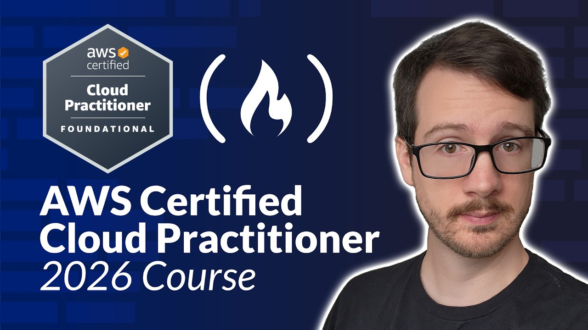
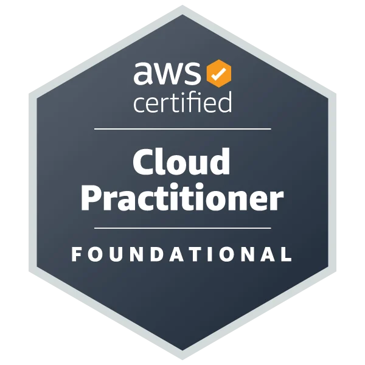

# AWS Certified Cloud Practitioner (CLF C02)
Welcome to the final milestone of Phase 1! This guide is designed especially for students, beginners, and tech enthusiasts who want to validate their cloud knowledge with an industry recognized credential from Amazon Web Services. Through clear domain breakdowns, a complete preparation course, and step by step registration guidance, you will prepare effectively to pass your exam and launch your cloud career!

### What You Will Learn
1. **Certification Overview:** Understand the exam structure, core domains, and career benefits of earning the AWS Certified Cloud Practitioner credential
2. **Core Exam Domains:** Master the four essential pillars covered in the assessment:
   * **Cloud Concepts:** Understanding the value and economics of cloud computing
   * **Security and Compliance:** Navigating the shared responsibility model and basic security controls
   * **Technology and Services:** Identifying key compute, storage, database, and networking tools
   * **Billing and Pricing:** Analyzing pricing models, support plans, and cost management
3. **Exam Preparation and Registration:** Access a complete preparation course, schedule your official exam, and discover pathways to obtain the certification for free  

***

### Contents
| # | Title | Description | Duration |
| :--- | :--- | :--- | :--- |
| 1 | [What is AWS Certified Cloud Practitioner (CLF C02)](#1-what-is-aws-certified-cloud-practitioner-clf-c02) | an entry level credential overview covering core domains, exam format, and job market value | - |
| 2 | [AWS Certified Cloud Practitioner Certification Course 2026](#2-aws-certified-cloud-practitioner-certification-course-2026-clf-c02---pass-the-exam) | a comprehensive preparation course covering everything needed to pass the exam | 13:00:00 |
| 3 | [Schedule Your Exam!](#3-schedule-your-exam) | guidance on registering and booking your official exam online or at a testing center | - |
| 4 | [How to Obtained the Certification for FREE](#4-how-to-obtained-the-certification-for-free) | exclusive pathways through AWS Builder Center and Manara to earn your certification at zero cost | - |

  
  

  
> 📌 **Important Note:**   All learning contents of this step are `100% free` and will prepare you completely to pass the official certification exam

***
### Contents Detailed

### 1. What is AWS Certified Cloud Practitioner (CLF-C02)

 

The AWS Certified Cloud Practitioner (CLF-C02) is an entry-level credential designed to validate a broad, foundational understanding of the Amazon Web Services cloud ecosystem without requiring deep technical or hands-on coding experience 

Covering four core domains: 
- cloud concepts
- security and compliance
- core AWS technology and services
- and billing and pricing

the exam has 65-question and takes 90-minute it make whether candidates understand what AWS services do, how the shared responsibility security model works, and how cloud economics operate. Priced at $100 USD(don't worry we will give to you for free) and valid for three years, it serves as an accessible starting point for students, career changers, and business professionals in roles like project management or sales who need shared cloud vocabulary to collaborate effectively with technical teams and build toward higher-level certifications

In the job market, this certificate works as a strong first impression. It gives your resume a clear advantage when applying for internships or entry level jobs, and it helps you pass the first screening stage. However, it is not enough on its own to get advanced engineering jobs. Instead, it acts as a strong base that you can build on later with specialized technical certificates and practical projects

***

### 2. AWS Certified Cloud Practitioner Certification Course 2026 (CLF-C02) - Pass the Exam!  

This video serves as a comprehensive preparation course for the AWS Certified Cloud Practitioner (CLF-C02) exam. It covers a vast range of foundational cloud concepts, AWS services, and operational frameworks 

This video has covered everything that is needed for the exam, in fact it has lot more! It provides deep dives into core security compliance models, billing structure, and hands on architecture walkthroughs, making it an ideal all in one resource for mastering cloud fundamentals 

We guarantee that after fully completing this video, you will be completely ready to pass the exam with confidence

 

***

### 3. Schedule Your Exam!  

Congratulations on reaching the final milestone of Phase 1! Now that you have built a strong theoretical and practical foundation, you are ready to officially register for the [**AWS Certified Cloud Practitioner**](https://aws.amazon.com/certification/certified-cloud-practitioner/) exam  

You can easily schedule your exam through the official **AWS Certification Portal** and choose to take it either online from the comfort of your home with a live proctor, or in person at an accredited testing center near you  

Make sure to review all core domains, take a few final practice tests, and book your exam date early to keep your commitment strong. Earning this globally recognized certification will validate your cloud fluency and unlock exciting opportunities in your tech career!

 

***

### 4. How to Obtained the Certification for *FREE*

#### 1. AWS Builder Center

#### 2. Manara

***

  
# Congratulations!  
on successfully completing Phase 1! You now have all the knowledge, practical experience, and guidance required to earn your AWS Certified Cloud Practitioner certification

### What Have You Learned
After finishing this phase, you learned:
- Understand the structure, domains, and career value of the AWS Certified Cloud Practitioner exam
- Master core cloud concepts, security models, AWS services, and billing structures
- Prepare thoroughly using a complete certification training course
- Know how to schedule your official exam and access free certification opportunities  

  
Keep this momentum going as you move forward to **Phase 2: Networking Fundamentals**
to dive deeper into cloud infrastructure, virtual private clouds, and network architecture

 

 

> ⭐ **Enjoying the Content?**  
> If you find this cloud computing roadmap, phase and current step helpful, please don't forget to **give this repository a star** and share it with other students so everyone can benefit!

***

### References

> • The official certification details, exam guide, and scheduling portal are hosted on [AWS Certified Cloud Practitioner](https://aws.amazon.com/certification/certified-cloud-practitioner/); see `certification_portal` for details

> • The comprehensive certification preparation video course is available at [AWS Certified Cloud Practitioner Certification Course 2026](https://youtu.be/7HKot-brXFE?si=6lHF1irg7yRRAT6V); check `exam_course` for reference

> • Foundational cloud services and global infrastructure overviews are detailed on [Amazon Web Services](https://aws.amazon.com/what-is-aws/); see `aws_overview` for details

> • Community collaboration, live support, and student discussions are coordinated through the <a href="https://chat.whatsapp.com/FYpwSMmx2D76qt2eAM0vtF?s=sh&p=a&iam=2" style="color: #58a6ff;">AWS Cloud Computing WhatsApp Group</a>; see <code>community-chat</code> for peer assistance. 

