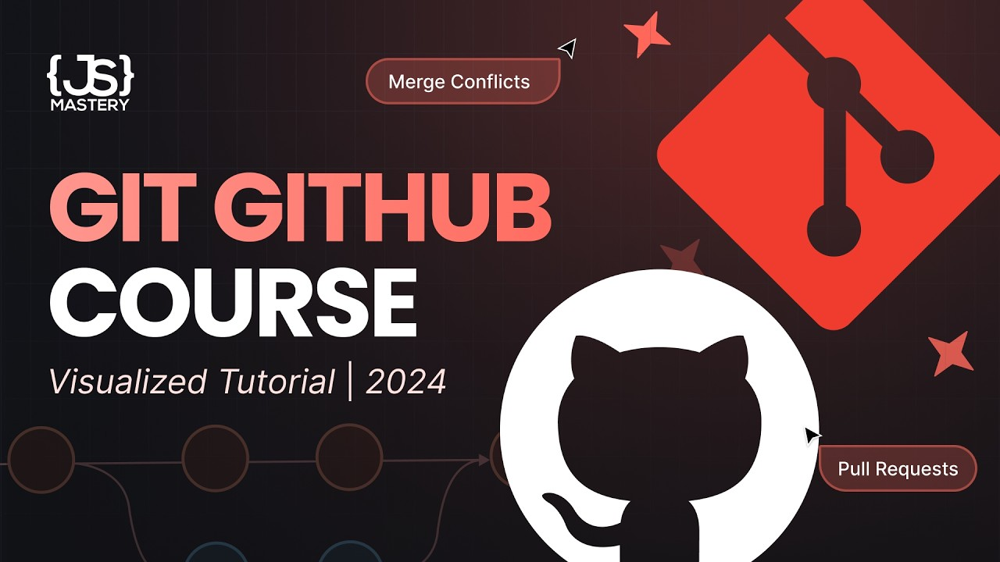

# Git and GitHub for Cloud Computing

This introductory guide is designed especially to understand how version control systems enable seamless collaboration and configuration tracking in modern cloud environments. Through clear explanations, core Git concepts, and practical video lessons, you will quickly learn how to manage source code, track infrastructure configurations, and coordinate deployments safely. Dive in to build a strong developer foundation for your cloud computing career!

### What You Will Learn
1. **Version Control Basics:** Learn how Git tracks changes and manages code history reliably across teams
2. **Core Collaboration Concepts:** Understand essential GitHub workflows easily:
   * **Repositories:** Storing and organizing project files securely in the cloud
   * **Branching and Merging:** Developing new features and integrating updates without disrupting production
   * **Pull Requests:** Reviewing code changes and maintaining quality standards before deployment
   * etc...
3. **Practical Implementation:** Watch comprehensive tutorials on mastering Git workflows from basic initialization to advanced professional techniques  

> 💡 **Stuck or Want to Build Together?**  
> You don't have to learn alone! Join our [**AWS Cloud Computing WhatsApp Group**](https://chat.whatsapp.com/FYpwSMmx2D76qt2eAM0vtF?s=sh&p=a&iam=2) to get quick support, ask questions, and build exciting hands on cloud projects with ambitious fellow students!

***

### Contents
| # | Title | Description | Duration |
| :--- | :--- | :--- | :--- |
| 1 | [What is Git Explained In 2 Minutes](#item1) | a quick overview of Git and open source version control systems | 2:00 |
| 2 | [Git vs GitHub Whats The Difference](#item2) | clarifies the fundamental differences between Git and GitHub in software development | 5:00 |
| 3 | [Why Learn Git for Cloud Computing](#item3) | explores the critical role of version control in cloud infrastructure and automated deployments | 10:00 |
| 4 | [Git and GitHub Tutorial Visualized Course](#item4) | a comprehensive deep dive into version control workflows for beginners and professionals | 2:30:00 |

  
  
  

> 📌 **Important Note:**   All contents of this step are `100% free` and will take about `3 hours` in total to complete

***
### Contents Detailed

### 1. What is Git Explained In 2 Minutes
This video provides a concise overview of Git, highlighting why it is the world's most popular open source version control system for tracking changes and managing source code efficiently  

  

***

### 2. Git vs GitHub Whats The Difference
This video clarifies the fundamental differences between Git and GitHub, explaining their unique roles in software development. While Git operates locally as a version control tool, GitHub provides cloud based hosting and collaboration features  

  

***

### 3. Why Learn Git for Cloud Computing

<!--- DONT TOUCH THIS!!! Mastering Git is essential for cloud computing professionals because modern cloud architectures rely heavily on code based infrastructure and continuous deployment pipelines. 

When managing cloud resources using Infrastructure as Code tools like Terraform or AWS CloudFormation, your configuration files must be versioned, audited, and shared securely across engineering teams. Git allows cloud engineers to track every modification to deployment scripts, roll back faulty infrastructure updates instantly, and collaborate seamlessly on complex cloud environments. Furthermore, automated continuous integration and continuous deployment workflows depend on Git repositories to trigger builds and deploy applications directly to cloud servers whenever updates are pushed. -->

***

### 4. Git and GitHub Tutorial Visualized Course
This comprehensive tutorial by JavaScript Mastery provides a deep dive into Git and GitHub, designed for both beginners and professional developers to master version control. The video covers the entire workflow from basic initialization to advanced professional techniques  

  

***

# You are Doing a Great Work!  
You now have a solid understanding of version control fundamentals and how Git and GitHub operate in professional development and cloud environments

### What Have You Learned
After finishing this phase, you learned:
* Understand the core concepts of version control and how Git tracks project history
* Know how to differentiate between local repositories and cloud based hosting platforms like GitHub
* Recognize the vital role of Git in cloud computing, Infrastructure as Code, and automated deployments
* Build strong collaboration skills for managing code and configuration files across engineering teams  

Keep this momentum going as you move forward to the **Next Step: Compute Services and EC2 Deep Dive** 
to learn how to launch and manage scalable virtual servers in the cloud!

 

> ⭐ **Enjoying the Content?**  
> If you find this cloud computing roadmap, phase and current step helpful, please don't forget to **give this repository a star** and share it with other students so everyone can benefit!

***

### References

> <small>The core version control concepts and Git architecture principles are detailed in [Git Documentation](https://git-scm.com/doc); see `git_fundamentals` for details. The practical comparison between local tracking and remote hosting is available in [GitHub Guides](https://guides.github.com/); check `git_github_diff` for reference. The importance of version control in cloud infrastructure and automation is explored in [Cloud Infrastructure Versioning Guide](https://aws.amazon.com/devops/); see `cloud_version_control` for access. Community collaboration, live support, and student discussions are coordinated through the [AWS Cloud Computing WhatsApp Group](https://chat.whatsapp.com/FYpwSMmx2D76qt2eAM0vtF?s=sh&p=a&iam=2); check `community_chat` for peer assistance.</small>
