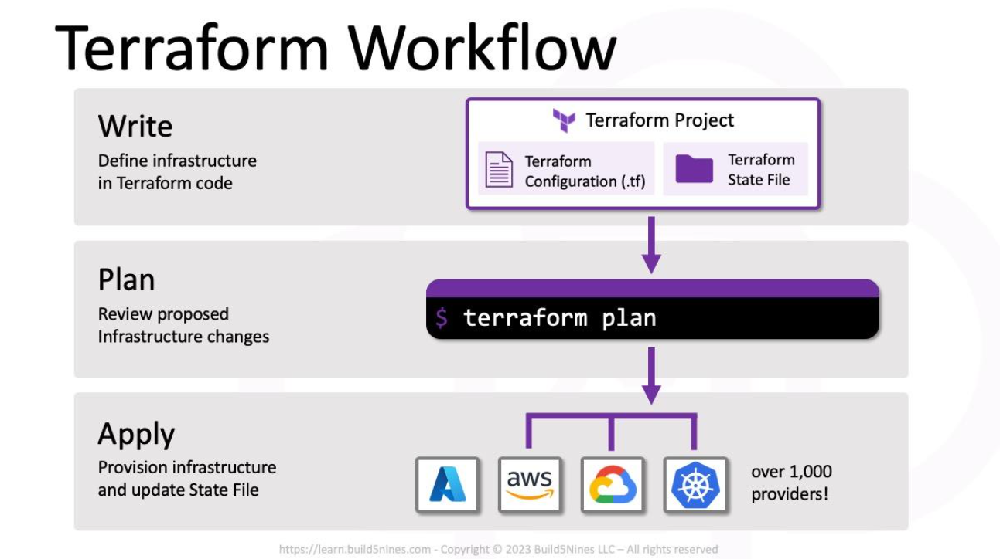
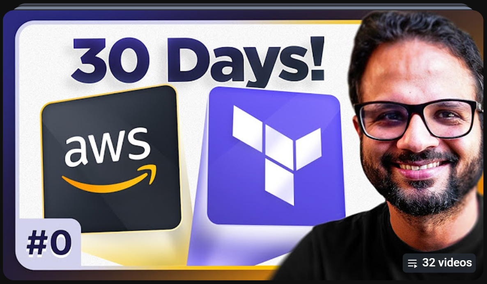
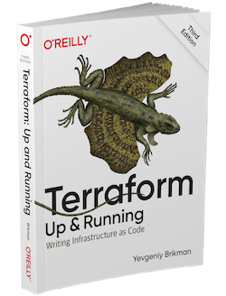
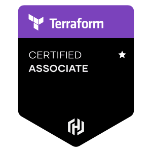

## Table of Contents

* [1- Definition and Introduction](#1--definition-and-introduction)
 * [For a Better Understanding](#for-a-better-understanding)
* [2- Now, Let's Dig in](#2--now-lets-dig-in)
 * [To Go Deeper](#to-go-deeper)
* [3- Additional](#3--additional)

---

# 1- Definition and Introduction 

| **What is Terraform?** | **ما هو تيرافورم؟** |
| :--- | ---: |
| Terraform is an open-source "Infrastructure as Code" (IaC) software tool created by HashiCorp. It enables developers and operations teams to define, provision, and manage cloud and on-premises infrastructure (such as virtual machines, networks, databases, and storage) safely and predictably using a simple, declarative configuration language known as **HCL (HashiCorp Configuration Language)**. | تيرافورم هي أداة برمجية مفتوحة المصدر لإدارة "البنية التحتية ككود" تم تطويرها بواسطة شركة هاشيكورب. تسمح لفرق التطوير والعمليات بإنشاء، وتعديل، وإدارة البنية التحتية لتكنولوجيا المعلومات (مثل الخوادم الافتراضية، الشبكات، قواعد البيانات، والتخزين) بطريقة آمنة وقابلة للتنبؤ باستخدام لغة تكوين وصفية بسيطة تُعرف باسم **إتش سي إل**. |
| **Key Features of Terraform:** | **:الميزات الرئيسية لـ تيرافورم** |
| **1- Multi-Cloud Support:** Terraform is not tied to a single cloud provider. It supports major cloud platforms like AWS, Microsoft Azure, and Google Cloud, as well as on-premises and container environments like VMware and Kubernetes. | 1- دعم متعدد السحاب: لا تقتصر تيرافورم على مزود سحابي واحد، بل تدعم أشهر المنصات السحابية مثل أيه دبليو إس(أمازون)، مايكروسوفت أزور، وجوجل كلاود، بالإضافة إلى البيئات المحلية وبيئات الحاويات مثل فيمير وكوبرنيتس. |
| **2- State Management:** It maintains a state file that maps your configuration files to your real-world infrastructure, allowing you to track resource changes efficiently and accurately. | 2- إدارة الحالة: تحتفظ الأداة بملف حالة يربط ملفات التكوين الخاصة بك بالبنية التحتية الواقعية، مما يتيح لك تتبع تغييرات الموارد بكفاءة ودقة. |
| **3- Execution Plans:** Terraform generates an execution plan showing what it will do (create, update, or destroy) before executing the changes, minimizing deployment errors. | 3- خطط التنفيذ: تنشئ تيرافورم خطة تنفيذ توضح ما ستفعله (إنشاء، تحديث، أو حذف) قبل تنفيذ التغييرات فعلياً، مما يقلل من أخطاء النشر. |
| **4- Modularity and Reusability:** It allows users to create reusable "Modules" to provision complex infrastructure environments consistently across different projects and environments. | 4- النمطية وإعادة الاستخدام: تسمح للمستخدمين بإنشاء "وحدات" قابلة لإعادة الاستخدام لتوفير بيئات بنية تحتية معقدة بشكل متسق عبر مختلف المشاريع والبيئات. |

# For a Better Understanding

| To Make It Clear | حتى تتضح الصورة |
| :--- | ---: |
| Imagine you are playing a city-building game. Usually, you build your city by clicking and placing one building at a time. It’s fun, but it’s hard to remember exactly how you built it, so you could never build the exact same city twice. Terraform is like a 'planning office' for computer infrastructure, enabling you to build the exact same city again automatically. | تخيل تيرافورم كأنك تلعب لعبة بناء مدن. عادةً، تقوم ببناء مدينتك عن طريق النقر ووضع المباني تلو الأخرى في كل مرة. ولكن يصعب تذكر كيفية بناءها بالضبط، لدرجة أنك لن تستطيع بناء نفس المدينة مرتين أبداً. تيرافورم يشبه "مكتب تخطيط" للبنية التحتية للحواسيب. يُمَكنك من بناء نفس المدينة بالضبط مرة اخرى وبشكل تلقائي. |

  
## Check out the following videos to learn more about Terraform:

  
 
<a href="https://youtu.be/vIROhFhJghw?si=E4yuYCQoGVjZOnvr"><b>What is Terraform in 3 Minutes (2026) | Terraform Tutorial for Beginners</b></a>

---

  
 
<a href="https://youtu.be/7S9HKPwfxDM?si=oGkV3eOz09XCjJIC"><b>Terraform in 5 Minutes (Explained Clearly)</b></a>

# 2- Now, Let's Dig in

.png)

| Terraform - Get Started on AWS | تيرافورم - ابدأ مع خدمات أمازون ويب |
| :--- | ---: |
| This beginner-friendly, hands-on learning path introduces Infrastructure as Code using HashiCorp Terraform and Amazon Web Services. | مسار تعليمي تطبيقي للمبتدئين يهدف إلى تعريف المتعلمين بمفهوم البنية التحتية بصفتها كودًا باستخدام أداة تيرافورم من شركة هاشي كورب ومنصة خدمات أمازون ويب. |
| It teaches learners how to automate the creation, modification, management, and deletion of cloud infrastructure through configuration files instead of manually provisioning resources through the AWS Management Console. | يركز المسار على تعلم كيفية أتمتة إنشاء البنية التحتية السحابية وتعديلها وإدارتها وحذفها من خلال كتابة ملفات الإعدادات البرمجية بدلًا من تنفيذ جميع العمليات يدويًا عبر لوحة تحكم أمازون ويب. |
| Throughout the learning path, learners will install and configure Terraform, connect it to AWS, write infrastructure configurations using HashiCorp Configuration Language, and deploy their first AWS EC2 instance. | خلال هذا المسار، سيتعلم المتدرب كيفية تثبيت وإعداد تيرافورم وربطه بحساب أمازون ويب، وكتابة ملفات إعداد البنية التحتية باستخدام لغة تكوين هاشي كورب، ثم تطبيق هذه الإعدادات لإنشاء أول خادم افتراضي باستخدام خدمة الحوسبة المرنة من أمازون. |
| The course also covers essential Terraform workflows, including initializing projects, validating configurations, planning infrastructure changes, applying configurations, managing variables and outputs, reusing configurations through modules, and destroying resources when they are no longer needed. | كما يتناول المسار دورة العمل الأساسية في تيرافورم، بما يشمل تهيئة المشاريع، والتحقق من صحة الإعدادات، ومعاينة التغييرات قبل تنفيذها، وتطبيق التعديلات، وإدارة المتغيرات والمخرجات، وإعادة استخدام الأكواد من خلال الوحدات البرمجية، بالإضافة إلى حذف الموارد السحابية عند الانتهاء منها. |
| Additionally, learners will get an introduction to team collaboration and remote state management using HCP Terraform. | ويقدم المسار مقدمة عن العمل الجماعي وإدارة حالة البنية التحتية عن بُعد باستخدام منصة هاشي كورب تيرافورم السحابية. |
| **By the end of this learning path, learners will be able to:** | **:بنهاية المسار، سيكون المتعلم قادرًا على** |
| 1- Understand Infrastructure as Code and its benefits. | 1- فهم مفهوم البنية التحتية بصفتها كودًا وأهميته . |
| 2- Install and configure Terraform. | 2- تثبيت وإعداد أداة تيرافورم. |
| 3- Connect Terraform with AWS. | 3- ربط تيرافورم بمنصة خدمات أمازون ويب. |
| 4- Write and manage basic Terraform configuration files. | 4- كتابة وإدارة ملفات إعداد تيرافورم. |
| 5- Provision and manage AWS EC2 infrastructure. | 5- إنشاء وإدارة الخوادم الافتراضية باستخدام خدمة الحوسبة المرنة من أمازون. |
| 6- Use Terraform CLI commands and workflows. | 6- استخدام الأوامر الأساسية لأداة تيرافورم. |
| 7- Work with variables, outputs, and modules. | 7- التعامل مع المتغيرات والمخرجات والوحدات البرمجية. |
| 8- Plan, apply, modify, and destroy infrastructure. | 8- تخطيط التغييرات وتنفيذها وإدارة الموارد السحابية وحذفها. |
| 9- Understand the basics of remote state and team collaboration using HCP Terraform. | 9- فهم أساسيات إدارة حالة البنية التحتية عن بُعد والتعاون الجماعي باستخدام منصة هاشي كورب تيرافورم السحابية. |

  
# [Terraform - Get Started on AWS](https://developer.hashicorp.com/terraform/tutorials/aws-get-started)

> **Important Note**
> Any service created on AWS may incur costs if left running. After every experiment, run the command `terraform destroy` to delete everything you created.

# To Go Deeper

| Series Overview | نظرة عامة على السلسلة |
| :--- | ---: |
| This series, "30 Days of AWS with Terraform," is a comprehensive, hands-on learning roadmap designed to take you from a beginner to an interview-ready professional in cloud infrastructure. | سلسلة «ثلاثون يومًا من خدمات أمازون ويب باستخدام تيرافورم» هي خارطة طريق تعليمية شاملة وتطبيقية، تهدف إلى نقل المتعلم من مستوى المبتدئ إلى مستوى يؤهله لاجتياز المقابلات الوظيفية في مجال البنية التحتية السحابية. |
| Led by Piyush Sachdeva, an industry expert with extensive credentials, the course focuses on pure, practical knowledge rather than shortcuts. | يقدمها بيوش ساشديفا، وهو خبير في المجال يمتلك خبرات ومؤهلات مهنية واسعة، وتركز السلسلة على اكتساب المعرفة النظرية والتطبيقية المتعمقة، مع التركيز على الممارسة العملية والمشاريع الواقعية بدلًا من الاعتماد على الحلول المختصرة أو الطرق السريعة. |

| Series Structure & Curriculum | هيكل السلسلة والمنهج التدريبي |
| :--- | ---: |
| A comprehensive hands on program designed to take learners from beginners to confident Terraform users. | برنامج تدريبي شامل وتطبيقي يهدف إلى نقل المتعلمين من مستوى المبتدئين إلى مستوى متقدم من الإتقان والثقة في استخدام أداة تيرافورم. |
| The series consists of 30 full length videos covering core concepts and real world projects. | تتكون السلسلة من 30 فيديو تدريبيًا كاملًا تغطي المفاهيم الأساسية والتطبيقات العملية والمشاريع الواقعية. |
| The course is divided into three core modules: | تنقسم الدورة إلى ثلاثة محاور رئيسية: |
| Module 1 (Days 1 to 13): Focuses on Terraform core concepts, including installation, providers, state management, variables, data types, meta arguments, and functions. | المحور الأول (الأيام 1 إلى 13): يركز على المفاهيم الأساسية لتيرافورم، بما في ذلك التثبيت، ومزودات الخدمات، وإدارة الحالة، والمتغيرات، وأنواع البيانات، والوسائط الإضافية، والدوال. |
| Module 2 (Days 14 to 24): Covers hands on projects, such as static website hosting, VPC peering, IAM management, Elastic Beanstalk with blue green deployment, Lambda triggers, EKS clusters, and scalable infrastructure with auto scaling. | المحور الثاني (الأيام 14 إلى 24): يتناول المشاريع والتطبيقات العملية، مثل استضافة المواقع الإلكترونية الثابتة، وربط الشبكات الافتراضية الخاصة، وإدارة الهويات والصلاحيات، ونشر التطبيقات باستخدام خدمة بيئة التطبيقات المرنة مع أسلوب النشر الأزرق والأخضر، وإعداد مشغلات الدوال السحابية، وإنشاء مجموعات كوبرنيتس المُدارة، وبناء بنية تحتية قابلة للتوسع باستخدام التوسع التلقائي. |
| Module 3 (Days 25 to 30): Explores advanced topics, including Terraform import, Terraform Cloud workspaces, CI CD pipelines, 3 tier architecture, GitOps with ArgoCD, and drift detection. | المحور الثالث (الأيام 25 إلى 30): يستكشف الموضوعات المتقدمة، بما في ذلك استيراد الموارد الموجودة إلى تيرافورم، وإدارة مساحات العمل عبر منصة تيرافورم السحابية، وإنشاء مسارات التكامل والتسليم المستمر، وبناء بنية معمارية ثلاثية الطبقات، وتطبيق مفهوم عمليات التطوير باستخدام أرجو سي دي، واكتشاف الانحرافات بين البنية التحتية الفعلية والإعدادات البرمجية. |

  
# [Learn AWS With Terraform in 30 Days (with real-time projects)](https://youtu.be/xUtGqC-NXJE?si=_ZrQuHWUthuQ2Vh8)

# 3- Additional

| Terraform Up and Running | About |
| :--- | :--- |
| 

 | Terraform: Up and Running is an educational and practical book focused on the concept of Infrastructure as Code (IaC). It aims to teach readers how to create, deploy, and manage cloud infrastructure using Terraform.  The author provides a practical explanation of Terraform concepts, starting with the fundamentals and progressing to building and managing complete, scalable infrastructure through code examples and real-world applications.  The book is not limited to using Terraform with Amazon Web Services (AWS); it also explores working with multiple cloud providers and technologies, including AWS, Google Cloud, and Microsoft Azure, in addition to containerization technologies and Kubernetes.  The book focuses on developing the skills needed to write reusable, testable, and maintainable infrastructure code, while managing infrastructure resources in an organized way, whether working individually or as part of a development team. |

| Certification Overview | Terraform Certified Associate |
| :--- | :--- |
| The HashiCorp Certified: Terraform Associate certification is a professional certification offered by HashiCorp. It aims to validate learners' fundamental knowledge and skills required to use Terraform to provision and manage infrastructure using the Infrastructure as Code (IaC) approach.  The certification focuses on assessing candidates' understanding of Terraform's core concepts, including writing configuration files, working with providers, managing infrastructure state, and creating, modifying, and destroying cloud resources.  It also covers concepts such as modules, variables, outputs, resource versioning, and infrastructure management in individual and team environments using HCP Terraform.  The certification aims to demonstrate a learner's ability to use Terraform to automate and manage infrastructure, serving as a suitable starting point for advancing toward more specialized roles in cloud infrastructure engineering. | 

 |
