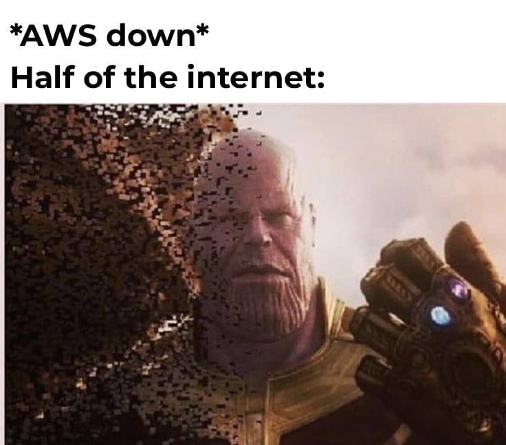
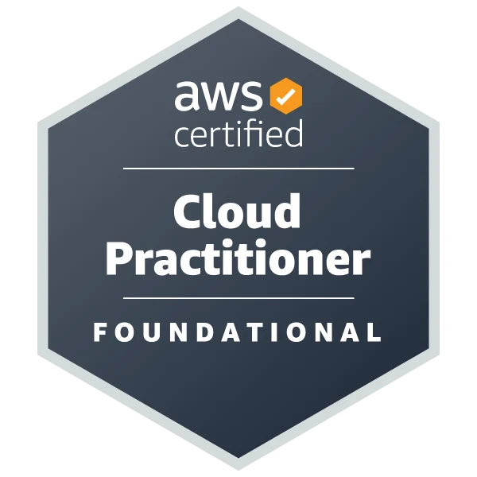
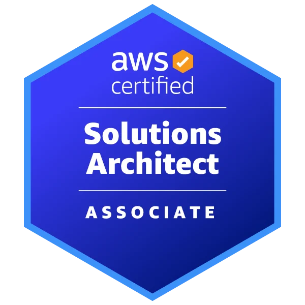

  <picture>
    <source media="(prefers-color-scheme: dark)" srcset="/media/RoadmapLogoWhite.png">
    <source media="(prefers-color-scheme: light)" srcset="/media/RoadmapLogoBlack.png">
    
  </picture>

  <picture>
    <source media="(prefers-color-scheme: dark)" srcset="/media/SponsorsWhite.png">
    <source media="(prefers-color-scheme: light)" srcset="/media/SponsorsBlack.png">
    
  </picture>

## About

This is a complete step-by-step cloud computing learning roadmap built for students and beginners using Amazon Web Services (AWS) 
where you will learn how to work with the cloud across different tech roles, and you will also dive deeper to master its core areas if your goal is to specialize in cloud engineering

## Why Cloud?

Today, modern companies rely heavily on cloud computing to build, host, and scale their applications, databases, and AI models instead of managing expensive physical servers. Learning how the cloud works gives you a major advantage in the job market, allowing you to deploy real projects online, handle large scale data, and build reliable systems with global reach 

 

So cloud computing is not just a specialized field for those who want to master every single detail of the cloud. Instead, it is an essential skill for every tech professional, because sooner or later, you will interact with it and use it in your work. This is exactly what this phase aims to achieve: giving you a solid foundational understanding so you can use the cloud comfortably and confidently in your projects!

 

## Why AWS Over Competitors?

  

Compared to competitors like Microsoft Azure and Google Cloud Platform (GCP), Amazon Web Services (AWS) is the most widely used cloud provider globally, offering the largest set of services, rich free training tools, and high demand certifications in the tech job market. Mastering AWS gives you a strong industry standard foundation that makes working with any cloud platform straightforward and confident!

 

***

We divided this roadmap into two clear phases so you can learn at the right pace based on your goals. Whether you want a solid cloud foundation for any tech role or aim to specialize in cloud engineering, each phase gives you a structured path with clear outcomes. **Phase 1** builds your core understanding of cloud concepts and AWS essentials, while **Phase 2** takes you deeper into hands on engineering tools, automation, and real world system architecture!

### Phase 1: Cloud Foundations (For All Tech Roles)
In this phase, you will build your core cloud foundation step by step by answering key questions: What is the cloud, and why do modern companies rely on it? How can you practice cloud concepts hands on through AWS Cloud Quest? How do cloud networking fundamentals work at a basic level? And how do you prepare to pass your first official cloud certification?

**In short:** You will start with cloud foundations, practice through AWS Cloud Quest, learn basic cloud networking, and get ready to earn the **AWS Certified Cloud Practitioner (CLF C02)** certification!

  

| Step / Topic | Description and Content | Estimated Time | Cost |
| :--- | :--- | :--- | :--- |
| [1. First Step to the Cloud: Foundations Made Simple](Phase-1/1%20First%20Step%20to%20the%20Cloud:%20Foundations%20Made%20Simple.md) | Core cloud computing concepts, service models, and AWS global infrastructure | ~2 to 3 Hours | Free |
| [2. AWS Cloud Quest: The Practical Gaming Experience](Phase-1/2%20AWS%20Cloud%20Quest:%20The%20Practical%20Gaming%20Experience.md) | Hands on practice with core AWS services inside an interactive 3D environment | ~10 to 15 Hours | Free |
| [3. Networking Fundamentals: Cloud Networking](Phase-1/3%20Networking%20Fundamentals:%20Cloud%20Networking.md) | Essential networking concepts including IP addressing, DNS, VPC basics, and security groups | ~4 to 6 Hours | Free |
| [4. AWS Certified Cloud Practitioner (CLF C02)](Phase-1/4%20AWS%20Certified%20Cloud%20Practitioner%20(CLF%20C02).md) | Structured exam preparation, study guides, and practice readiness for your first certification | ~15 to 25 Hours | Free learning ($100 USD optional exam fee) |

> **Phase 1 Summary:** Completing Phase 1 takes approximately **30 to 50 hours** in total. All learning materials and labs are **100% free**, and the only optional cost is **$100 USD** if you decide to take the official AWS Certified Cloud Practitioner exam (with free voucher programs often available for students).

***

### Phase 2: Cloud Engineering and Architecture (For Specialists)
In this phase, you will move into deeper engineering and architecture topics by answering key questions: How do you use Git and GitHub for cloud workflows? How do you manage Linux systems and build stronger networking skills? How do you automate cloud tasks with Python and manage infrastructure with Terraform? And how do real Solutions Architects design secure, resilient, and cost optimized systems on AWS?

**In short:** You will build practical engineering skills across Git and GitHub, Linux, advanced networking, Python, and Terraform, preparing you for cloud roles and the **AWS Certified Solutions Architect Associate** certification!

 

| Step / Topic | Description and Content | Estimated Time | Cost |
| :--- | :--- | :--- | :--- |
| [1. Git and GitHub for Cloud Computing](Phase-2/1%20Git%20and%20GitHub%20for%20Cloud%20Computing.md) | Version control fundamentals, repositories, branching, and collaborative workflows | ~5 to 8 Hours | Free |
| [2. Linux Administration Essentials](Phase-2/Linux.md) | Operating system management, command line navigation, permissions, and Bash scripting | ~15 to 20 Hours | Free |
| [3. Network Advanced: Deep Dive Into Networking](Phase-2/Networking%20Advanced:%20Deep%20Dive%20Into%20Networking.md) | Deep dive into routing, subnetting, VPNs, hybrid connectivity, and enterprise cloud networking | ~20 to 30 Hours | Free |
| [4. Infrastructure as Code with Terraform](Phase-2/Terraform.md) | Automating cloud infrastructure deployment using HCL language, modules, and state management | ~12 to 18 Hours | Free |
| [5. Python for Cloud Automation](Phase-2/python.md) | Python programming fundamentals and automating AWS tasks using the Boto3 SDK and Lambda | ~15 to 20 Hours | Free |
| [6. AWS Certified Solutions Architect Associate](Phase-2/AWS%20Certified%20Solutions%20Architect%20Associate.md) | Designing secure, resilient, high performing, and cost optimized architectures on AWS | ~35 to 50 Hours | Free learning ($150 USD optional exam fee) |

> **Phase 2 Summary:** Completing Phase 2 takes approximately **100 to 145 hours** in total depending on your prior technical background. All study guides, courses, and tools are **100% free**, with an optional **$150 USD** fee only if you choose to sit for the official AWS Certified Solutions Architect Associate exam.

