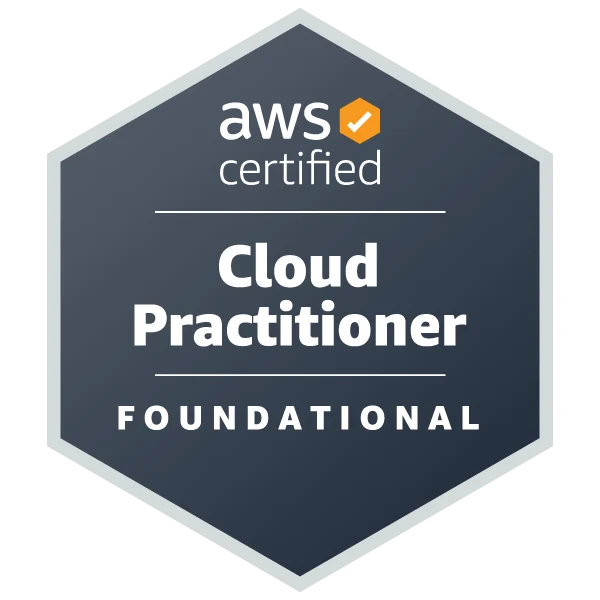

### Phase 1: Cloud Foundations (For All Tech Roles)
In this phase, you will build your core cloud foundation step by step by answering key questions: What is the cloud, and why do modern companies rely on it? How can you practice cloud concepts hands on through AWS Cloud Quest? How do cloud networking fundamentals work at a basic level? And how do you prepare to pass your first official cloud certification?

**In short:** You will start with cloud foundations, practice through AWS Cloud Quest, learn basic cloud networking, and get ready to earn the **AWS Certified Cloud Practitioner (CLF C02)** certification!

 

| Step | Description and Content | Estimated Time | Cost |
| :--- | :--- | :--- | :--- |
| [1. First Step to the Cloud: Foundations Made Simple](https://github.com/WESAMAAM/cloud-computing-roadmap/blob/main/phase-1%20/1%20First%20Step%20to%20the%20Cloud%3A%20Foundations%20Made%20Simple.md) | Core cloud computing concepts, service models, and AWS global infrastructure | ~ 4 Hours | Free |
| [2. AWS Cloud Quest: The Practical Gaming Experience](https://github.com/WESAMAAM/cloud-computing-roadmap/blob/main/phase-1%20/2%20%20AWS%20Cloud%20Quest%3A%20The%20Practical%20Gaming%20Experience.md) | Hands on practice with core AWS services inside an interactive 3D environment | ~ 13 Hours | Free |
| [3. Networking Fundamentals: Cloud Networking](https://github.com/WESAMAAM/cloud-computing-roadmap/blob/main/phase-1%20/3%20Networking%20Fundamentals%3A%20Cloud%20Networking.md) | Essential networking concepts including IP addressing, DNS, VPC basics, and security groups | ~ 4 Hours | Free |
| [4. AWS Certified Cloud Practitioner (CLF C02)](https://github.com/WESAMAAM/cloud-computing-roadmap/blob/main/phase-1%20/4%20AWS%20Certified%20Cloud%20Practitioner%20(CLF%20C02).md) | Structured exam preparation, study guides, and practice readiness for your first certification | ~ 15 Hours | Free ($100 USD free voucher for the exam!) |

> Completing Phase 1 takes approximately **``~ 40 to 50 hours / ~ 5 weeks - 10 hours per week``** in total, All learning materials are **``100% free``**, and the only optional cost is **$100 USD** if you decide to take the official AWS Certified Cloud Practitioner exam (without the free voucher)

