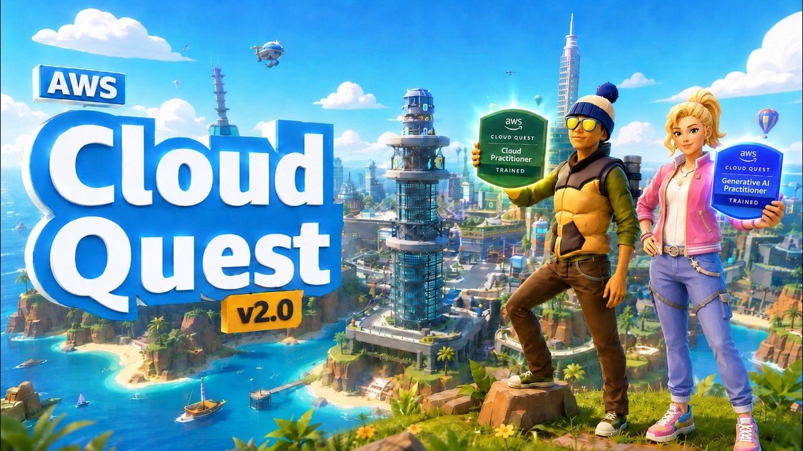
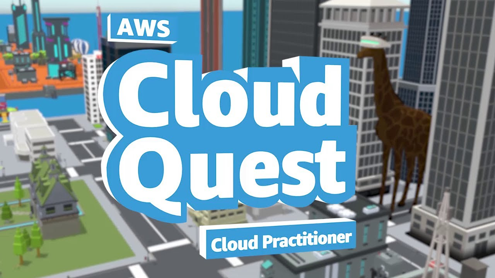
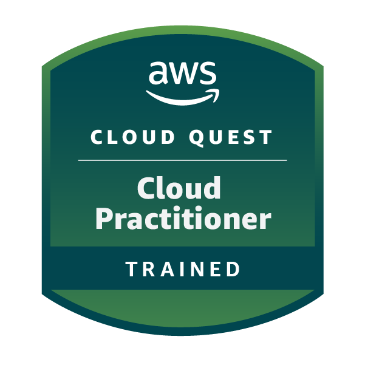
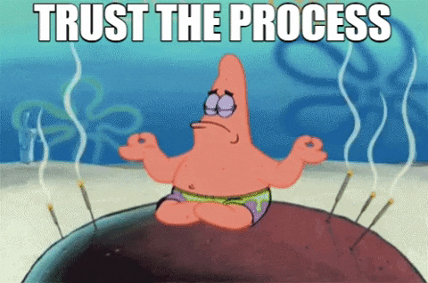

# AWS Cloud Quest: The Practical Gaming Experience

Welcome to the core of Phase 1! This interactive guide is designed especially for beginners, developers and tech enthusiasts who want to transition from passive video learning to active, gamified cloud mastery using Amazon Web Services, Through immersive 3D role playing, real world challenges, and practical scenario solving, you will quickly build professional cloud skills while having fun, Dive in to level up your career!

### What You Will Learn
1. **Cloud Foundations Through Gaming:** Learn how to configure cloud resources, manage storage, and deploy applications inside an interactive virtual city environment
2. **Core AWS Services:** Gain hands on experience with essential tools:
   * **Amazon S3:** Configuring secure cloud storage buckets for client data
   * **Amazon EC2:** Launching and managing virtual servers to host live applications
   * **Auto Scaling:** Designing resilient architectures to handle high web traffic dynamically
   * etc...
3. **Practical Problem Solving:** Complete real world technical scenarios that prepare you directly for professional cloud engineering tasks  

***

### Contents
| # | Title | Description | Duration |
| :--- | :--- | :--- | :--- |
| 1 | [AWS Cloud Quest 2.0](#1-aws-cloud-quest-20--amazon-web-services) | introduces AWS Cloud Quest 2.0 as an interactive, role based learning platform on AWS Skill Builder | 1:37 |
| 2 | [Cloud Practitioner Quest](#item2) | introduces AWS Cloud Quest: Cloud Practitioner as an interactive open world role playing game | 1:12 |
| 3 | [Why AWS Cloud Quest Matters?](#3-why-is-aws-cloud-quest-an-essential-part-of-your-journey) | explains why this 3D game format serves as the core and heart of practical learning in Phase 1 | - |
| 4 | [Start Playing the Game](#4-start-playing-aws-cloud-quest) | provides direct access to launch your gameplay, community support links, and pacing guidance | 12:00:00 |

  
  
  

> 📌 **Important Note:**   All contents of this step are `100% free` and will take about `13 hours` in total to complete

***
### Content Detailed
### 1. AWS Cloud Quest 2.0 | Amazon Web Services
This video introduces AWS Cloud Quest 2.0 as an interactive, role-based learning platform on [`AWS Skill Builder`](https://aws.amazon.com/training/digital/) designed to help users transition from simply building cloud solutions to learning how to design them effectively  

  

***

### 2. AWS Cloud Quest - Cloud Practitioner | Amazon Web Services
This video introduces AWS Cloud Quest: Cloud Practitioner as an interactive, open-world role-playing game designed to help users build practical Amazon Web Services skills in an engaging environment  

  

***

  
### 3. Why is AWS Cloud Quest an Essential Part of Your Journey?
Is there a more enjoyable way to learn than playing a game?

 

This step is the core and heart of Phase 1 because it teaches you cloud computing through an engaging and fun 3D game format. You step into the role of a Cloud Practitioner in a virtual city, and helping real businesses solve their cloud challenges 

For example:
- you will fulfill client requests by configuring [`Amazon S3`](https://aws.amazon.com/s3/?trk=aebc39a1-139c-43bb-8354-211ac811b83a&sc_channel=ps&ef_id=Cj0KCQiA-8XXBhDaARIsADnEOrCong2gARvjTDHjVwXM_GNgjZtQukn-iKk9ehQGallfko4OpSbhH94aAr7FEALw_wcB:G:s&gads_camp=23846236784&gads_ag=200318255990&gads_ad=808827666179&gads_kw=amazon%20s3&gads_matchtype=e&gads_network=g&gads_device=c&gads_geo=9241351&gad_campaignid=23846236784&gbraid=0AAAAADjHtp8lvG7CLZIOhGMIXtmajrCSp&gclid=Cj0KCQiA-8XXBhDaARIsADnEOrCong2gARvjTDHjVwXM_GNgjZtQukn-iKk9ehQGallfko4OpSbhH94aAr7FEALw_wcB) buckets for secure storage
- setting up Amazon EC2 instances to host applications
- and designing auto scaling solutions to handle high web traffic 

 This practical approach makes learning highly effective while serving as exceptional preparation for the official AWS Certified Cloud Practitioner exam witch is the end goal of this phase  

so don't worry, trust us on this

 

  

***

### 4. Start Playing: AWS Cloud Quest  

This game specifically focuses on the Cloud Practitioner role, helping you build core practical skills 

If you face any challenge or have questions while playing, we strongly recommend joining our [**AWS Cloud Computing WhatsApp Group**](https://chat.whatsapp.com/FYpwSMmx2D76qt2eAM0vtF?s=sh&p=a&iam=2) to get support and participate in hands on cloud projects with fellow students! 

Additionally, if you get stuck on any specific quest, searching on social media platforms or asking AI tools can quickly help you overcome the obstacle 

The game takes about 12 hours in total to complete 
However, you do not need to finish all 12 hours in one sitting before moving forward, You can easily balance your time by progressing through the game while simultaneously advancing to the next step in this Phase 

Play the game and learn at your own pace, enjoy!

 

***

We recommend continuing to the next step while playing the game! This keeps your momentum going and allows you to learn theory alongside your practical gameplay.

### What Have You Learned

After completing this part, you have learned:

* Understand the core concepts of cloud computing and virtualized environments
* Gain practical experience with essential AWS services through interactive hands on challenges
* Prepare effectively for foundational cloud certifications such as the AWS Certified Cloud Practitioner
* Solve real world technical scenarios in an engaging 3D gaming environment  

Keep this momentum going as you move forward to the **Next Step: Networking Fundamentals** 
to learn how cloud networks and traffic routing work!

 

> ⭐ **Enjoying the Content?**  
> If you find this cloud computing roadmap, phase and current step helpful, please don't forget to **give this repository a star** and share it with other students so everyone can benefit!

***

### References

> • The digital training platform and skill builder resources are hosted on [AWS Skill Builder](https://aws.amazon.com/training/digital/); see `skill_builder` for details

> • The video overview introducing AWS Cloud Quest 2.0 and platform features is available at [AWS Cloud Quest 2.0 Video](https://youtu.be/JnPkam4giq8?si=QTdqMgXo_h3OKBh6); see `quest_video` for reference

> • The video introduction covering the Cloud Practitioner game environment is featured in [Cloud Practitioner Video](https://youtu.be/lcmVvIeiFGc?si=QEEgNUavaFxo1BG6); check `practitioner_video` for details

> • The official interactive 3D role playing learning platform is hosted on [AWS Cloud Quest Training](https://skillbuilder.aws/learn/FU5WCYVGKY/aws-cloud-quest-cloud-practitioner/JF9TKU68GT); see `cloud_quest` for access

> • The cloud storage service used for secure client data configuration is detailed on [Amazon S3](https://aws.amazon.com/s3/); see `amazon_s3` for pricing and features

> • Community collaboration, live support, and student discussions are coordinated through the [AWS Cloud Computing WhatsApp Group](https://chat.whatsapp.com/FYpwSMmx2D76qt2eAM0vtF?s=sh&p=a&iam=2); check `community_chat` for peer assistance

