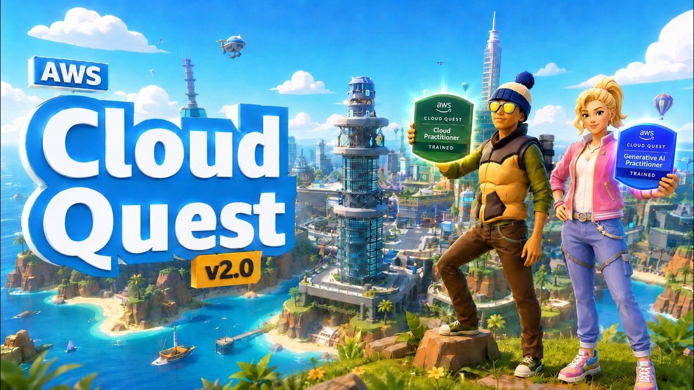
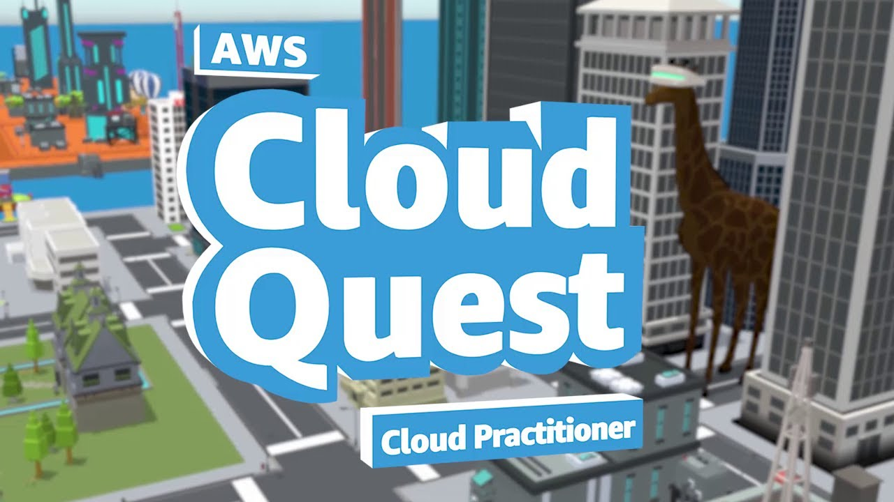

### 1. AWS Cloud Quest 2.0 | Amazon Web Services

  

***

### 2. AWS Cloud Quest - Cloud Practitioner | Amazon Web Services

  

***

### 3.

**الهدف:** تعلم أساسيات AWS بشكل تفاعلي (بصيغة لعبة)
**المدة المتوقعة:** ... (نكتبها لاحقاً)
**التكلفة:** (نتأكد من الموقع الرسمي)

## وش بيستفيد الطالب
بعد إنهاء هذه الخطوة، يكون عنده اطلاع جيد على أساسيات الكلاود بشكل تطبيقي.

## المصادر
- (نضيف رابط AWS Cloud Quest الرسمي هنا)

## ملاحظات
- نتأكد إن اللعبة متاحة حالياً وشروط التسجيل
