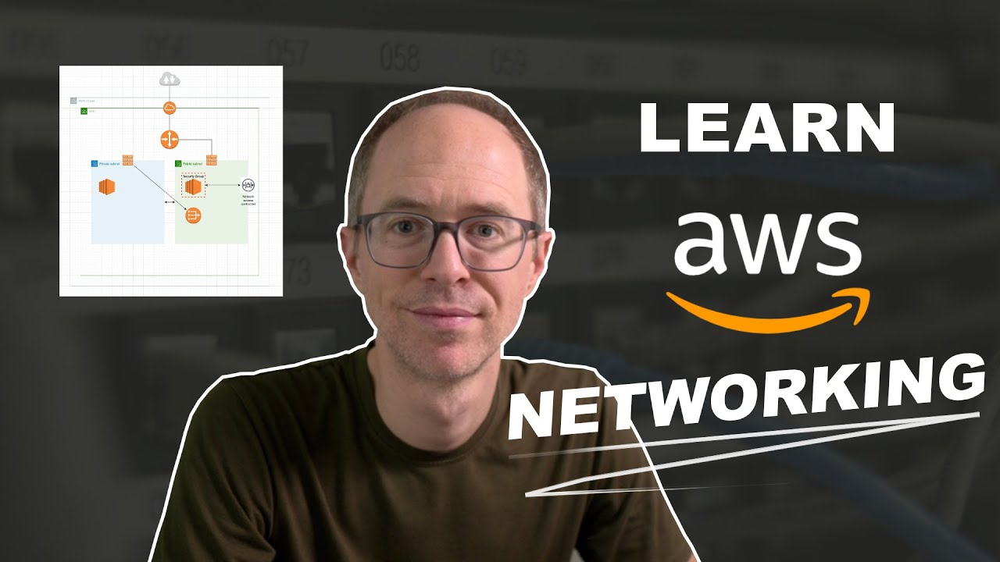
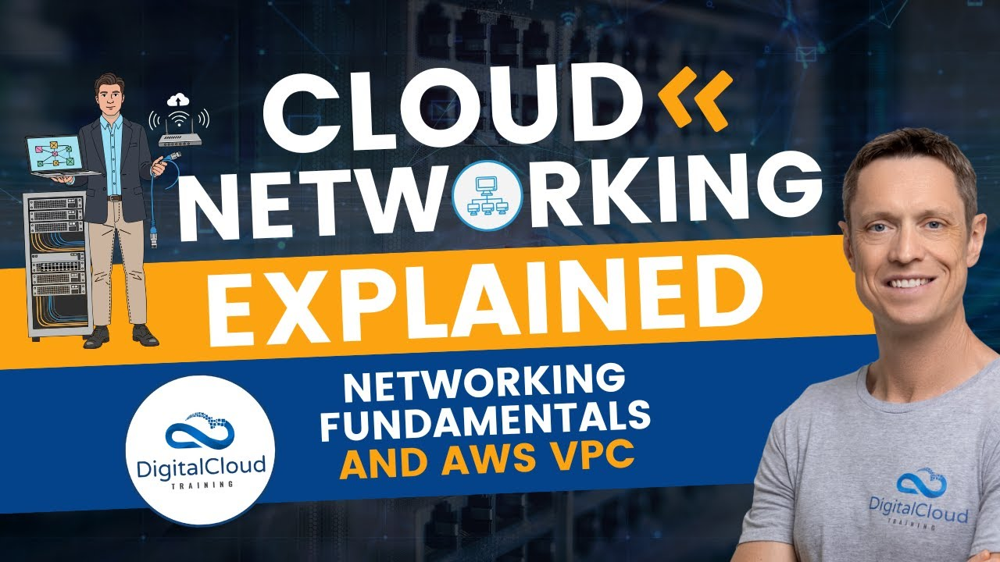

***

### 1. Abdulrahman do the paragraph here

***

### 2. AWS Networking Basics For Programmers | Hands On
This video serves as a practical guide for programmers looking to understand the fundamentals of AWS networking. The creator walks through building a secure network architecture from scratch in AWS, moving beyond theory to explain core components and terminology

  

***

### 3. AWS Networking

This playlist is a twelve-part series titled "AWS Networking" created by Digital Cloud Training, Its primary goal is to bridge the gap between traditional, foundational networking concepts and their implementation within modern cloud environments, specifically Amazon Web Services (AWS) 

 

***
