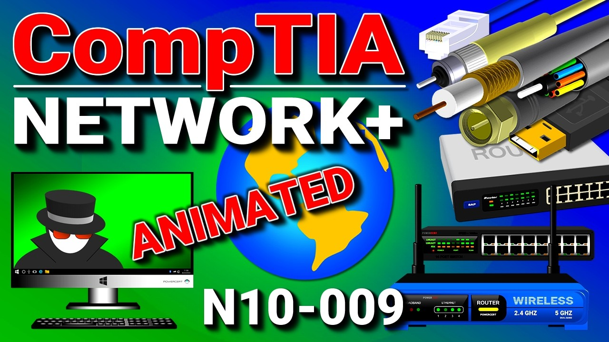
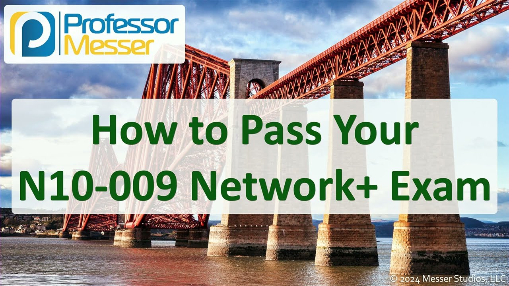
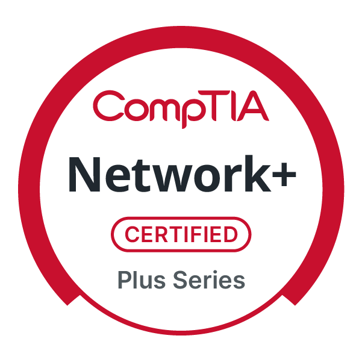

> Phase 2 is not ready yet and is currently under consideration, To stay updated and get notified, join our [**AWS Cloud Computing WhatsApp Group!**](https://chat.whatsapp.com/FYpwSMmx2D76qt2eAM0vtF?s=sh&p=a&iam=2)

<!---# Networking Advanced: Deep Dive Into Networking

This advanced guide is designed especially for cloud engineers seeking to master complex network architectures, traffic routing, and enterprise security models. Through comprehensive exploration of advanced networking protocols, hybrid cloud connectivity, and industry certification courses, you will build the expertise required to design, deploy, and troubleshoot large scale cloud environments with confidence.

### What You Will Learn
1. **Enterprise Routing and Switching:** Master advanced routing protocols and traffic management across distributed cloud topologies.
2. **Hybrid Cloud Connectivity:** Understand how to connect on premise datacenters securely to cloud environments using virtual private networks and dedicated connections.
3. **Advanced Security and Firewalls:** Implement robust network security controls, zero trust architectures, and deep packet inspection.
4. **Troubleshooting and Performance Optimization:** Learn systematic approaches to diagnose latency bottlenecks, packet loss, and routing failures in production.

> 💡 **Stuck or Want to Build Together?**  
> You don't have to learn alone! Join our [**AWS Cloud Computing WhatsApp Group**](https://chat.whatsapp.com/FYpwSMmx2D76qt2eAM0vtF?s=sh&p=a&iam=2) to get quick support, ask questions, and build exciting hands on cloud projects with ambitious fellow students!

***

### Contents
| # | Title | Description | Duration |
| :--- | :--- | :--- | :--- |
| 1 | [Why Going Deeper in Networking is Important](#item1) |  |  |
| 2 | [CompTIA Network Plus N10 009 Full Course](#item2) |  |  |
| 3 | [CompTIA Network Plus Certified Guide](#item3) |  |  |
| 4 | [CompTIA N10 009 Network Plus Training Course](#item4) |  |  |

  
  

> 📌 **Important Note:**   All contents of this step are `100% free` and will take about `? hours` in total to complete

***
### Contents Detailed

### 1. Why Going Deeper in Networking is Important to Mastering Cloud Computing

<!--- DONT TOUCH THIS!!! Mastering advanced networking is the cornerstone of becoming an elite cloud architect or DevOps engineer. While basic cloud deployments allow you to launch virtual servers easily, real world production environments demand intricate understanding of how data flows across global infrastructure. 

When managing enterprise scale cloud systems, you will encounter complex scenarios involving hybrid cloud connectivity, cross region VPC peering, Transit Gateway route tables, and Border Gateway Protocol routing. Without deep networking knowledge, diagnosing latency bottlenecks, resolving intermittent packet loss, or securing multi tier applications against sophisticated cyber threats becomes nearly impossible. Furthermore, advanced networking expertise empowers you to design highly resilient, fault tolerant architectures that ensure seamless availability for millions of users worldwide--->

***

### 2. CompTIA Network+ N10-009 Full Certification Course

  

***

### 3. CompTIA Network+ Certified

 

***

### 4. CompTIA N10-009 Network+ Training Course

  

***

# You are Doing a Great Work!  
You now have an advanced understanding of enterprise networking principles and how secure topologies operate in cloud environments

### What Have You Learned
After finishing this phase, you learned:
* Master advanced routing protocols and traffic management across distributed cloud architectures
* Understand hybrid cloud connectivity and how to link on premise datacenters securely
* Implement robust network security controls and zero trust defensive models
* Troubleshoot complex cloud network failures and optimize performance for enterprise workloads  

Keep this momentum going as you move forward to the **Next Step: Advanced Cloud Security and IAM** 
to learn how to protect and govern your cloud infrastructure at scale!

 

> ⭐ **Enjoying the Content?**  
> If you find this cloud computing roadmap, phase and current step helpful, please don't forget to **give this repository a star** and share it with other students so everyone can benefit!

***

### References

> <small>The advanced cloud networking principles and architecture guidelines are detailed in [AWS Networking Documentation](https://aws.amazon.com/networking/); see networking guide for details. The comprehensive certification syllabus and exam objectives are available in [CompTIA Network Plus Overview](https://www.comptia.org/certifications/network); check exam blueprint for reference. Enterprise routing and security strategies are explored in [Cloud Connectivity Best Practices](https://aws.amazon.com/whitepapers/); see architecture whitepaper for access. Community collaboration and study groups are coordinated through the [AWS Cloud Computing WhatsApp Group](https://chat.whatsapp.com/FYpwSMmx2D76qt2eAM0vtF?s=sh&p=a&iam=2); check community chat for peer assistance.</small>
