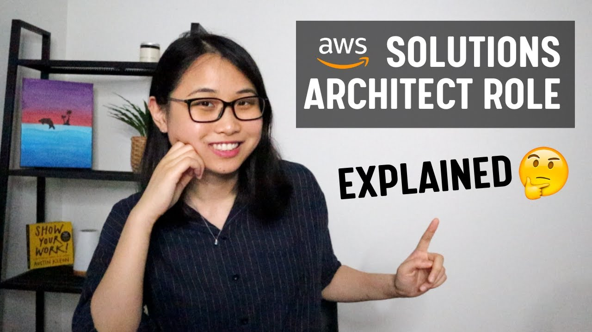
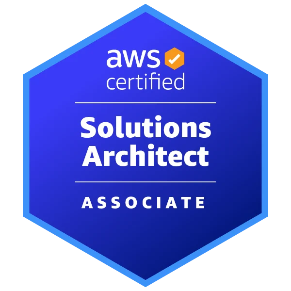

> Phase 2 is not ready yet and is currently under consideration, To stay updated and get notified, join our [**AWS Cloud Computing WhatsApp Group!**](https://chat.whatsapp.com/FYpwSMmx2D76qt2eAM0vtF?s=sh&p=a&iam=2)

<!---# AWS Certified Solutions Architect Associate: Architecture and Design Guide

Welcome to this intermediate guide in your cloud computing journey! This section is designed for students, developers, and aspiring cloud architects who want to move from basic cloud familiarity to designing scalable, secure, and cost efficient systems on Amazon Web Services. Through clear architectural concepts, real world role insights, and structured preparation guidance, you will learn how to build resilient cloud solutions that meet business requirements!

### What You Will Learn
1. **Why Solutions Architect Associate:** Understand the career impact, architectural mindset, and practical value of earning the AWS Certified Solutions Architect Associate certification
2. **Real World Role Insights:** Hear directly from an AWS Associate Solutions Architect about daily responsibilities, system design decisions, and collaboration across teams
3. **Core Architectural Domains:** Master the four foundational pillars covered in the exam:
   * **Design Secure Architectures:** Securing access, workloads, and data across AWS environments
   * **Design Resilient Architectures:** Building fault tolerant, highly available systems with disaster recovery strategies
   * **Design High Performing Architectures:** Selecting optimal compute, storage, database, and networking components
   * **Design Cost Optimized Architectures:** Balancing performance and reliability with smart resource and pricing choices  

  
> 📌 **Platform Focus:**  This guide focuses on [**Amazon Web Services (AWS)**](https://aws.amazon.com/certification/certified-solutions-architect-associate/) because its Well Architected Framework and broad service ecosystem set the industry standard for modern cloud architecture design

***

### Contents
| # | Title | Description | Duration |
| :--- | :--- | :--- | :--- |
| 1 | [Why AWS Certified Solutions Architect Associate](#1-why-aws-certified-solutions-architect--associate) | explores the career value, architectural skills, and exam structure of the Associate credential | - |
| 2 | [What Does An AWS Solutions Architect Actually Do?](#2-what-does-an-aws-solutions-architect-actually-do) | real world perspective from Lucy on daily responsibilities and architectural problem solving at AWS | - |
| 3 | [AWS Certified Solutions Architect Associate Exam](#3-aws-certified-solutions-architect-associate-exam) | overview of exam format, timing, and official certification details | - |
| 4 | [How to get it for free](#4-how-to-get-it-for-free) | pathways and opportunities to prepare and pursue certification at zero cost | - |

  
  

  
> 📌 **Important Note:**   All learning resources in this section are `100% free` and designed to strengthen your system design mindset step by step

***
### Contents Detailed

### 1. Why AWS Certified Solutions Architect - Associate
Earning the AWS Certified Solutions Architect Associate credential validates your ability to design secure, resilient, high performing, and cost optimized architectures on AWS based on the AWS Well Architected Framework. It signals strong practical problem solving skills and sets a high standard for roles in cloud engineering, systems design, and technical consulting  

The exam consists of 65 questions with a duration of 130 minutes, priced at $150 USD, and remains valid for three years. It covers four scored domains:
- Design Secure Architectures (30%)
- Design Resilient Architectures (26%)
- Design High Performing Architectures (24%)
- Design Cost Optimized Architectures (20%)  

In the job market, this certification carries substantial weight for aspiring cloud engineers and architects because it tests architectural trade offs rather than isolated definitions. Pairing it with hands on labs and real projects helps you stand out when applying for cloud and infrastructure roles

***

### 2. What Does An AWS Solutions Architect Actually Do?
in this video, Lucy, an Associate Solutions Architect at AWS, explains the core responsibilities and daily life of someone in this role  

  

> 💡 **Stuck or Want to Build Together?**  
> You don't have to learn alone! Join our vibrant [**AWS Cloud Computing WhatsApp Community**](https://chat.whatsapp.com/FYpwSMmx2D76qt2eAM0vtF?s=sh&p=a&iam=2) to get quick support, ask questions, and build exciting hands on cloud projects with ambitious fellow students!

***

### 3. AWS Certified Solutions Architect Associate Exam

 

Not Finished Yet!

 

***

### 4. How to get it for free
Building toward this certification does not have to start with heavy expenses. You can take advantage of free AWS digital training, hands on labs, community programs, and regional initiatives to build your skills and watch for promotional vouchers or sponsorship opportunities along the way  

***

  
# Congratulations!  
on exploring the AWS Certified Solutions Architect Associate path! You now have a clearer view of cloud architecture design and what the role involves in practice

### What Have You Learned
After finishing this section, you learned:
- Why the AWS Certified Solutions Architect Associate certification is valued for cloud architecture roles
- What daily responsibilities and architectural decisions look like through Lucy's walkthrough
- How the exam domains, format, and free learning pathways fit into your study plan  

> ⭐ **Enjoying the Content?**  
> If you find this cloud computing roadmap, phase and current step helpful, please don't forget to **give this repository a star** and share it with other students so everyone can benefit!

***

### References

> • Official certification overview, exam format, and scheduling details are hosted on [AWS Certified Solutions Architect Associate](https://aws.amazon.com/certification/certified-solutions-architect-associate/); see `saa_overview` for details

> • Role insights from an AWS Associate Solutions Architect are featured in [What Does An AWS Solutions Architect Actually Do?](https://youtu.be/xPZt3Z9nkT0?si=JEMnpXH7g5HiRytR); check `solutions_architect_role` for reference

> • Community collaboration, live support, and student discussions are coordinated through the [**AWS Cloud Computing WhatsApp Community**](https://chat.whatsapp.com/FYpwSMmx2D76qt2eAM0vtF?s=sh&p=a&iam=2); check `community_chat` for peer assistance

