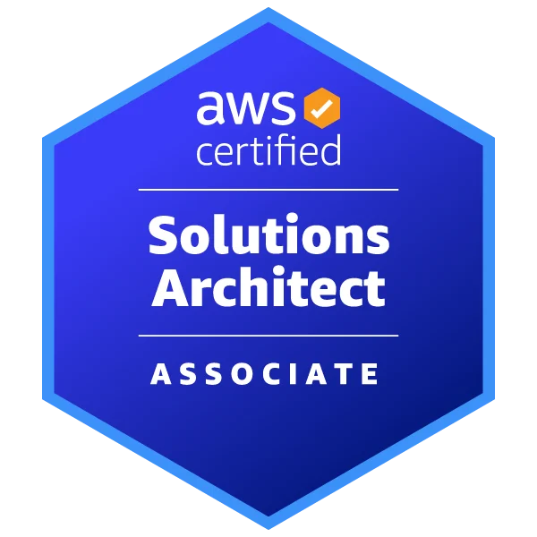

### Phase 2: Cloud Engineering and Architecture (For Specialists)
In this phase, you will move into deeper engineering and architecture topics by answering key questions: How do you use Git and GitHub for cloud workflows? How do you manage Linux systems and build stronger networking skills? How do you automate cloud tasks with Python and manage infrastructure with Terraform? And how do real Solutions Architects design secure, resilient, and cost optimized systems on AWS?

**In short:** You will build practical engineering skills across Git and GitHub, Linux, advanced networking, Python, and Terraform, preparing you for cloud roles and the **AWS Certified Solutions Architect Associate** certification!

 

| Step | Description and Content | Estimated Time | Cost |
| :--- | :--- | :--- | :--- |
| 1. Git and GitHub for Cloud Computing | Version control fundamentals, repositories, branching, and collaborative workflows | - | - |
| 2. Linux Administration Essentials | Operating system management, command line navigation, permissions, and Bash scripting | - | - |
| 3. Network Advanced: Deep Dive Into Networking | Deep dive into routing, subnetting, VPNs, hybrid connectivity, and enterprise cloud networking | - | - |
| 4. Infrastructure as Code with Terraform | Automating cloud infrastructure deployment using HCL language, modules, and state management | - | - |
| 5. Python for Cloud Automation | Python programming fundamentals and automating AWS tasks using the Boto3 SDK and Lambda | - | - |
| 6. AWS Certified Solutions Architect Associate | Designing secure, resilient, high performing, and cost optimized architectures on AWS | - | - |

> Phase 2 is not ready yet and is currently under consideration, To stay updated and get notified, join our [**AWS Cloud Computing WhatsApp Group!**](https://chat.whatsapp.com/FYpwSMmx2D76qt2eAM0vtF?s=sh&p=a&iam=2)

